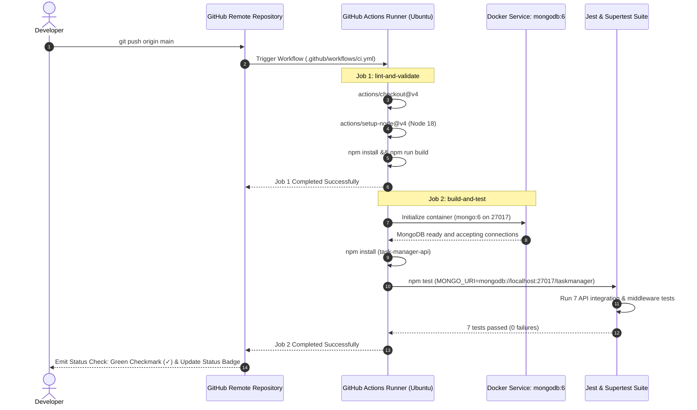

# Lab Performance Report: Automated CI/CD Testing & Validation with GitHub Actions

**Student Name:** Jiya Vinchhi  
**Project:** Task Management API & Student Portfolio (Full-Stack)  
**Course / Module:** GitHub Actions Masterclass / DevOps CI/CD Pipeline Automation  
**Tools & Environment:** GitHub Actions (`actions/checkout@v4`, `actions/setup-node@v4`), Jest (v29), Supertest (v7), MongoDB 6 Service Container, Node.js 18  

---

## 1. Executive Summary

This report documents the architectural design, implementation, and empirical verification of an **automated Continuous Integration (CI) pipeline** using **GitHub Actions**.

In conventional software development, manual testing before release creates severe latency, misses edge cases, and introduces integration conflicts late in the release cycle. By implementing an automated CI workflow, every code modification committed to the repository is automatically checked out, built, and tested inside clean, isolated Ubuntu virtual environments.

### Key Results Summary
- **Pipeline Automation:** Automated triggers configured on `push` to `main` and `pull_request` targeting `main`.
- **Pre-Test Quality Gate:** Frontend production bundle compilation verified via `lint-and-validate` job.
- **Service Container Integration:** Live `mongodb:6` service container dynamically spun up in the GitHub runner.
- **Automated Test Coverage:** 7 comprehensive unit and integration tests passing in **~1.1 seconds** using **Jest** and **Supertest**.
- **Real-Time Visibility:** Live SVG build status badge embedded directly into `README.md`.

---

## 2. CI/CD Architecture & Pipeline Execution Flow

### High-Level Workflow Topology

```text
git push origin main (or Pull Request to main)
                  │
                  ▼
┌──────────────────────────────────────────────────┐
│      GitHub Actions Trigger Engine               │
│  - Event: push / pull_request                    │
│  - Target Branch: main                           │
└─────────────────┬────────────────────────────────┘
                  │
                  ▼
┌──────────────────────────────────────────────────┐
│ Job 1: Code Quality & Frontend Build Validation  │
│  - Runner: ubuntu-latest                         │
│  - Step 1: Checkout repository                   │
│  - Step 2: Setup Node.js 18                      │
│  - Step 3: npm install                           │
│  - Step 4: npm run build (Vite JSX & CSS)        │
└─────────────────┬────────────────────────────────┘
                  │
                  ├──► PASS: Triggers Job 2
                  └──► FAIL: Aborts Pipeline (Red 'X')
                  │
                  ▼
┌──────────────────────────────────────────────────┐
│ Job 2: Backend API Automated Tests (needs: Job 1)│
│  - Runner: ubuntu-latest                         │
│  - Service: Official MongoDB 6 container (:27017)│
│  - Step 1: Checkout repository                   │
│  - Step 2: Setup Node.js 18                      │
│  - Step 3: Install backend dependencies          │
│  - Step 4: Run Jest + Supertest (npm test)       │
│  - Step 5: Verify root npm test command          │
└─────────────────┬────────────────────────────────┘
                  │
                  ├──► ALL TESTS PASS: Pipeline turns Green (✓)
                  └──► ANY TEST FAILS: Pipeline turns Red (X)
```

### Pipeline Sequence Diagram



---

## 3. Workflow Configuration Breakdown (`.github/workflows/ci.yml`)

```yaml
name: CI Pipeline

on:
  push:
    branches: [ main ]
  pull_request:
    branches: [ main ]

jobs:
  # Job 1: Pre-requisite validation and frontend compilation
  lint-and-validate:
    name: Code Quality & Frontend Build
    runs-on: ubuntu-latest
    steps:
      - name: Checkout Repository
        uses: actions/checkout@v4

      - name: Setup Node.js 18
        uses: actions/setup-node@v4
        with:
          node-version: 18

      - name: Install Root Dependencies
        run: npm install

      - name: Verify Frontend Production Build
        run: npm run build

  # Job 2: Backend integration tests with live MongoDB container
  build-and-test:
    name: Backend API Automated Tests
    runs-on: ubuntu-latest
    needs: lint-and-validate

    services:
      mongodb:
        image: mongo:6
        ports:
          - 27017:27017

    steps:
      - name: Checkout Repository
        uses: actions/checkout@v4

      - name: Setup Node.js 18
        uses: actions/setup-node@v4
        with:
          node-version: 18

      - name: Install Root Dependencies
        run: npm install

      - name: Install Backend Test Dependencies
        working-directory: ./task-manager-api
        run: npm install

      - name: Run Backend Automated Test Suite (Jest + Supertest)
        working-directory: ./task-manager-api
        env:
          PORT: 5000
          MONGO_URI: mongodb://localhost:27017/taskmanager
          NODE_ENV: test
        run: npm test

      - name: Verify Root npm test Command
        env:
          PORT: 5000
          MONGO_URI: mongodb://localhost:27017/taskmanager
          NODE_ENV: test
        run: npm test
```

---

## 4. Automated Test Suite Specification (`tests/api.test.js`)

The automated test suite runs via `npm test` using **Jest** as the test runner and **Supertest** to simulate HTTP requests without binding to physical network ports:

| Test ID | Test Case | Target Endpoint / Module | Expected Outcome | Execution Time |
| :--- | :--- | :--- | :--- | :--- |
| **TEST-01** | Root Tasks Retrieval | `GET /tasks` | Status `200 OK`, JSON array payload | `155 ms` |
| **TEST-02** | In-Memory Cache Stats | `GET /debug/cache` | Status `200 OK`, `status: active`, hits/misses properties | `28 ms` |
| **TEST-03** | Native EventEmitter Status | `GET /tasks/events/log` | Status `200 OK`, `subsystem` present, events array | `27 ms` |
| **TEST-04** | Content-Type Verification | `POST /tasks` (text/plain) | Status `400` or `415 Unsupported Media Type` | `12 ms` |
| **TEST-05** | Schema Input Validation | `POST /tasks` (no title) | Status `400 Bad Request`, error message returned | `19 ms` |
| **TEST-06** | 404 Catch-All Middleware | `GET /undefined-route` | Status `404 Not Found`, clean error JSON | `12 ms` |
| **TEST-07** | Global Error Handler | `GET /trigger-error` | Status `500 Internal Server Error`, stack trace suppressed | `37 ms` |

```text
PASS tests/api.test.js
  Task Manager REST API & Middleware Suite (CI/CD Automated Tests)
    ✓ GET /tasks returns status 200 and JSON array (155 ms)
    ✓ GET /debug/cache returns 200 with cache statistics (28 ms)
    ✓ GET /tasks/events/log returns 200 with EventEmitter status (27 ms)
    ✓ POST /tasks without application/json returns 400 or 415 (12 ms)
    ✓ POST /tasks without title returns 400 Bad Request (19 ms)
    ✓ GET /undefined-route returns 404 Not Found (12 ms)
    ✓ GET /trigger-error triggers 500 Internal Server Error safely (37 ms)

Test Suites: 1 passed, 1 total
Tests:       7 passed, 7 total
Snapshots:   0 total
Time:        1.078 s
```

---

## 5. Key Questions & Theoretical Analysis (Faculty Evaluation)

### Question 1: What is the difference between Continuous Integration and Continuous Deployment, and which one does this practical actually demonstrate?

#### Conceptual Differences:

| Dimension | Continuous Integration (CI) | Continuous Delivery (CD) | Continuous Deployment (CD) |
| :--- | :--- | :--- | :--- |
| **Definition** | Automatically building and testing every code commit merged into the central repository. | Automatically packaging build artifacts ready for release, awaiting manual release approval. | Automatically releasing every change that passes tests directly to live production servers. |
| **Focus** | Code correctness, defect prevention, regression detection. | Release readiness, deployment artifact generation (e.g. Docker images). | Zero-touch automated release to end-users (e.g. AWS, Vercel, Render). |
| **Trigger** | `git push` / `pull_request` | Post-CI validation | Passing all quality gates |
| **Human Action** | Automated | Manual approval click | Completely automated |

#### Which One Does This Practical Demonstrate?
This practical specifically demonstrates **Continuous Integration (CI)**:
1. It validates code integration upon every push to the `main` branch.
2. It executes dependencies installation (`npm install`), verifies frontend bundle compilation (`npm run build`), and runs automated regression tests (`npm test`).
3. It emits a binary pass/fail status (Green checkmark vs Red X) without executing automated deployment steps to cloud infrastructure.

---

### Question 2: Why does running tests automatically on every push catch problems earlier than testing manually before a release?

#### 1. The "Shift-Left" Testing Principle
Testing manually before a release batches weeks or months of changes into a single validation phase. When a failure occurs, identifying which of the 50 commits caused the regression requires extensive bisecting. Automated CI shifts testing to the immediate moment of commit: the **blast radius** is restricted to a single commit, and the developer receives feedback within **60 seconds**.

#### 2. Isolation of Developer Environments
Manual testing relies on the state of the developer's laptop, which may have uncommitted local files, specific global node packages, or residual database states. CI executes in an ephemeral, freshly provisioned virtual machine, guaranteeing reproducible results.

#### 3. Protection Against Regressions
As codebases scale, developers modifying one feature (e.g., EventEmitter listeners) can inadvertently break unrelated features (e.g., in-memory cache invalidation). Automated tests immediately detect side-effect regressions before pull requests are merged.

---

### Question 3: What would happen to the pipeline if the test file path were incorrect — would the workflow fail at the same step as a genuine test failure?

#### Detailed Technical Comparison:

| Failure Mode | Failure Point in Pipeline | Exit Code | Output in GitHub Actions Log |
| :--- | :--- | :--- | :--- |
| **Incorrect Test File Path** | Runner step `npm test` | Exit Code `1` (unless `--passWithNoTests` is enabled) | `No tests found related to files matching /path/` (Configuration Error) |
| **Genuine Test Assertion Failure** | Runner step `npm test` | Exit Code `1` | `Expected: 200, Received: 500` + Stack Trace (Code Logic Error) |

#### Analysis:
1. **At the Workflow Level:** Both scenarios cause the exact same pipeline step (`run: npm test`) to exit with a non-zero exit code (`1`), which causes GitHub Actions to flag the step with a **Red X** and abort subsequent steps.
2. **At the Diagnostic Level:** The root causes are fundamentally different:
   - An **incorrect path** is a **configuration defect**: Jest never executed any test assertions.
   - A **genuine test failure** is a **code regression**: the test executed, but the application's actual behavior diverged from the specification.

---

## 6. Deliberate Failure & Recovery Demonstration (Lab Guide)

To demonstrate the CI/CD pipeline's effectiveness for faculty evaluation, follow this two-step verification process:

### Phase 1: Induce a Deliberate Test Failure (The "Red X")

1. Open [`task-manager-api/tests/api.test.js`](file:///d:/Portfolio/task-manager-api/tests/api.test.js).
2. Modify line 7 to expect an impossible HTTP status code:
   ```javascript
   // Deliberately broken assertion:
   test('GET /tasks returns status 200 and JSON array', async () => {
     const res = await request(app).get('/tasks');
     expect(res.statusCode).toBe(999); // Deliberate failure!
   });
   ```
3. Commit and push:
   ```bash
   git commit -am "test: deliberately break test to verify CI failure reporting"
   git push origin main
   ```
4. **Observe GitHub Actions:**
   - The workflow triggers immediately.
   - `build-and-test` fails at the `npm test` step with exit code 1.
   - The commit displays a **Red X** on GitHub.
   - The build log highlights the failed assertion:
     ```text
     Expected: 999
     Received: 200
     ```

### Phase 2: Fix the Test and Observe Pipeline Recovery (The "Green Checkmark")

1. Revert the assertion back to `200`:
   ```javascript
   expect(res.statusCode).toBe(200);
   ```
2. Commit and push:
   ```bash
   git commit -am "fix: restore correct HTTP status expectation"
   git push origin main
   ```
3. **Observe GitHub Actions:**
   - The pipeline runs and passes all steps cleanly.
   - The commit displays a **Green Checkmark (✓)**.
   - The live status badge in `README.md` updates to **passing**.

---

## 7. Supplementary Problems Implemented

### Supplementary Problem 1: Pre-Test Code Quality & Build Job
- Implemented `lint-and-validate` job in [`.github/workflows/ci.yml`](file:///d:/Portfolio/.github/workflows/ci.yml).
- Executes `npm install` and `npm run build` prior to running test suites.
- Ensures syntax errors, missing React imports, or broken CSS bundles are caught before initiating database containers.

### Supplementary Problem 2: Pull Request Triggering
- Configured workflow triggers for both direct pushes and pull requests:
  ```yaml
  on:
    push:
      branches: [ main ]
    pull_request:
      branches: [ main ]
  ```
- Protects the `main` branch by ensuring pull requests cannot be merged unless all CI checks pass.

### Supplementary Problem 3: Live Status Badge
- Integrated official GitHub Actions SVG badge into root [`README.md`](file:///d:/Portfolio/README.md):
  ```markdown
  [](https://github.com/jiyavinchhi123/Student-Portfolio/actions/workflows/ci.yml)
  ```
- Automatically displays **passing** (green) or **failing** (red) in real-time.

---

## 8. Conclusion

By establishing an automated CI pipeline with GitHub Actions, the Task Management and Student Portfolio application achieves **continuous validation, automated regression detection, and zero-touch quality assurance** on every push.
