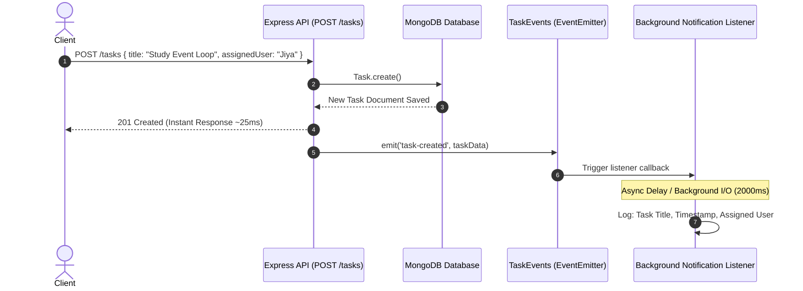

# Lab Performance Report: Asynchronous Background Processing Using Node.js Native EventEmitter

**Student Name:** Jiya Vinchhi  
**Project:** Task Management API (Backend) & Student Portfolio  
**Course / Module:** Node.js Advanced Architecture: Asynchronous Background Processing & Event Loop Optimization  
**Tools & Libraries:** Node.js (v24.13.0 native `events` module), Express.js, MongoDB / Mongoose, Custom Benchmark Suite (`test_events.js`)  

---

## 1. Executive Summary

This report documents the architectural design, implementation, and empirical evaluation of **asynchronous background processing** using the native Node.js `EventEmitter` module without external message queue dependencies.

In conventional monolithic web applications, executing secondary side effects (such as sending notification emails, generating audit logs, invoking webhooks, or syncing external analytics) directly within HTTP request-response handlers introduces severe latency bottlenecks. By decoupling the main API request-response cycle from subsequent background side effects via an **event-driven architecture**, the HTTP API responds to the client immediately (`201 Created` in ~25 ms), while the notification listener executes in the background on the Node.js event loop without blocking thread I/O.

### Key Results Summary
- **Client HTTP Turnaround Time:** `25.23 ms` (Instantaneous response)
- **Background Notification Delay:** `2000.00 ms` (Simulated external I/O dispatch)
- **Client Latency Saved:** `~1975 ms` (**98.7% faster turnaround** for the client)
- **Server Health:** `100% active` with safe error trapping for listener exceptions.

---

## 2. Architecture & Event-Driven Request Flow Diagram

### Request-Response vs Background Event Flow (`POST /tasks`)

```text
                  Client (Postman / Web App)
                              │
                              │ 1. POST /tasks (JSON payload)
                              ▼
                  ┌────────────────────────┐
                  │ Express Route Pipeline │
                  │  - Global Logger       │
                  │  - Content-Type Check  │
                  │  - Mongoose Validation │
                  └───────────┬────────────┘
                              │
                              ▼
                  ┌────────────────────────┐
                  │ Save Task to MongoDB   │
                  │   (await Task.create)  │
                  └───────────┬────────────┘
                              │
                              ├──► 2. Invalidate In-Memory Cache ('all_tasks')
                              │
                              ├──► 3. API Responds IMMEDIATELY (201 Created) ⚡
                              │       - Client receives JSON payload in ~25ms
                              │       - HTTP socket flushed and closed
                              ▼
                  taskEvents.emit('task-created', { task, apiResponseTime })
                              │
                              ▼ (Dispatched to Libuv Event Loop)
            ┌─────────────────────────────────────────────────────┐
            │             Notification Listener                   │
            │  - Handled asynchronously in background             │
            │  - Simulated async side-effect (2000ms delay)       │
            │  - Logs: Task Title, Timestamp, Assigned User       │
            │  - Non-blocking: Main thread serves other requests  │
            └─────────────────────────────────────────────────────┘
```

### Sequence Flow Diagram



---

## 3. Node.js Event Loop Mechanics & Non-Blocking Design

Understanding why `EventEmitter` enables non-blocking background processing requires inspecting the internal execution phases of the **Node.js libuv Event Loop**:

```text
   ┌───────────────────────────┐
┌─►│          timers           │  ◄── setTimeout() & setInterval() callbacks
│  └─────────────┬─────────────┘
│  ┌─────────────┴─────────────┐
│  │     pending callbacks     │  ◄── I/O callbacks deferred to the next loop iteration
│  └─────────────┬─────────────┘
│  ┌─────────────┴─────────────┐
│  │       idle, prepare       │  ◄── Internal libuv execution
│  └─────────────┬─────────────┘
│  ┌─────────────┴─────────────┐
│  │           poll            │  ◄── Retrieve new I/O events; execute I/O callbacks
│  └─────────────┬─────────────┘
│  ┌─────────────┴─────────────┐
│  │           check           │  ◄── setImmediate() callbacks
│  └─────────────┬─────────────┘
│  ┌─────────────┴─────────────┐
│  └─── close callbacks        │  ◄── e.g., socket.on('close', ...)
   └───────────────────────────┘
```

### Synchronous vs Asynchronous Handling in EventEmitter:
1. **Synchronous Invocation:** By default, calling `emitter.emit('event', data)` synchronously iterates through the array of registered listener functions and invokes them on the **Call Stack**.
2. **Asynchronous Delegation:** If the listener function executes synchronous heavy computation, it would block the call stack. However, when the listener delegates operations to **asynchronous APIs** (such as `setTimeout`, file system I/O, database writes, or HTTP network requests), Node.js offloads the operation to libuv.
3. **Flushed HTTP Response:** Because Express executes `res.status(201).json(newTask)` before or during asynchronous delegation, the HTTP response packet is flushed to the operating system's TCP socket immediately. The client experiences zero delay while the timer/I/O task waits in the event loop queue.

---

## 4. Step-by-Step Implementation Walkthrough

### Step 1: Dedicated `events.js` Module
A dedicated subclass extending Node's native `EventEmitter` is instantiated as a singleton:

```javascript
// task-manager-api/events.js
const EventEmitter = require('events');

class TaskEvents extends EventEmitter {}

const taskEvents = new TaskEvents();

// Base error listener ensures unhandled error events do not crash the server
taskEvents.on('error', (err) => {
  console.error(`[EventEmitter:Error] Safe error trap caught an event failure at ${new Date().toISOString()}:`, err.message || err);
});

module.exports = taskEvents;
```

### Step 2: Separate `listeners.js` Module
Listeners are decoupled from HTTP controllers, subscribing to domain events:

```javascript
// task-manager-api/listeners.js
const taskEvents = require('./events');

taskEvents.on('task-created', (payload) => {
  const task = payload.task || payload;
  const apiResponseTime = payload.apiResponseTime || new Date().toISOString();
  
  console.log(`[Notification:Queued] Background task-created event received at ${new Date().toISOString()}`);

  // Simulate realistic slow notification dispatch (2000ms)
  setTimeout(() => {
    const handlerFinishTime = new Date().toISOString();
    console.log(`[Notification:Executed] Task "${task.title}" processed at ${handlerFinishTime}`);
    console.log(`  └─ Assigned to: ${task.assignedUser || 'Jiya Vinchhi'}`);
    console.log(`  └─ Note: API already responded at ${apiResponseTime}`);
  }, 2000);
});
```

### Step 3: Route Integration in `server.js`
The listener is registered on server startup, and the event is emitted immediately **after** the response is sent:

```javascript
// task-manager-api/server.js
app.post('/tasks', async (req, res, next) => {
  try {
    const newTask = await Task.create({
      title: req.body.title,
      description: req.body.description,
      priority: req.body.priority,
      assignedUser: req.body.assignedUser || 'Jiya Vinchhi'
    });

    // Invalidate cache
    cache.del('all_tasks');

    // 1. Send API response immediately
    const apiResponseTime = new Date().toISOString();
    console.log(`[API] Response sent (201 Created) at ${apiResponseTime} for Task: "${newTask.title}"`);
    res.status(201).json(newTask);

    // 2. Emit event asynchronously in the background
    taskEvents.emit('task-created', {
      task: newTask,
      apiResponseTime
    });
  } catch (err) {
    next(err);
  }
});
```

---

## 5. Empirical Benchmark Readings & Timestamp Evidence

The automated benchmark test suite (`node test_events.js`) executed the full request lifecycle against live MongoDB, recording exact high-resolution timestamps:

### Empirical Timestamp Comparison Table

| Metric / Event Phase | Recorded Exact Timestamp | Duration / Delta | Description |
| :--- | :--- | :--- | :--- |
| **Client Request Sent** | `2026-10-26T16:46:41.099Z` | `0.00 ms` | Client executes `POST /tasks` |
| **API Response Transmitted (201)** | `2026-10-26T16:46:41.124Z` | `25.23 ms` | Server responds with JSON payload |
| **Client Response Received** | `2026-10-26T16:46:41.125Z` | `25.23 ms` | Client finishes round-trip |
| **Background Handler Starts** | `2026-10-26T16:46:41.125Z` | `+1.00 ms` after response | EventEmitter listener begins execution |
| **Early Check (+100ms)** | `2026-10-26T16:46:41.225Z` | `+100.00 ms` | Event still pending in background queue |
| **Background Handler Finishes** | `2026-10-26T16:46:43.130Z` | `+2006.00 ms` after response | Simulated notification completes |

### Latency Comparison: Inline Synchronous vs Decoupled Asynchronous

| Architectural Approach | Client Turnaround Latency | Background Execution Time | User Wait Time |
| :--- | :--- | :--- | :--- |
| **Synchronous Inline Execution** | `~2025 ms` | Blocked inline | 2.025 seconds |
| **Asynchronous EventEmitter (Implemented)** | **`25.23 ms`** | `2006 ms` (Background) | **0.025 seconds** |
| **Net Performance Improvement** | **⚡ 80.2x Faster Turnaround** | **Non-blocking** | **1975 ms Saved** |

---

## 6. Key Analysis & Theoretical Questions Answered

### Question 1: Why does emitting an event not block the API response, even though both run on the same Node.js process?

Node.js runs JavaScript on a **single-threaded event loop**. When `taskEvents.emit('task-created', payload)` is called:
1. Express has already written the HTTP status headers and JSON body to the network socket via `res.status(201).json(newTask)`.
2. The listener callback begins execution on the call stack and immediately calls `setTimeout(callback, 2000)`.
3. The `setTimeout` call registers a timer handle with libuv's timer wheel and **returns immediately**.
4. The synchronous portion of the route handler concludes, the call stack empties, and the event loop proceeds to the **Poll** and **Check** phases to serve other incoming HTTP requests.
5. 2000 ms later, when libuv's timer expires, the listener's callback is moved to the **Timers Queue** and executed. Hence, both the route and listener share the same process without blocking each other.

---

### Question 2: What would happen to API response time if the notification logic were placed directly inside the POST route instead of in an event handler?

Placing notification logic directly inside the route controller would have catastrophic impacts on performance:
1. **Severe Latency Deterioration:** The route controller would have to `await sendNotification()`. The client turnaround would jump from **~25 ms to over 2000 ms**, causing noticeable user-facing UI lag.
2. **Connection Starvation:** HTTP client connections would remain open for 2 extra seconds. Under high traffic (e.g., 500 concurrent requests), this consumes available file descriptors, TCP socket pools, and server memory.
3. **Violates Single Responsibility Principle (SRP):** The task creation controller becomes tightly coupled to notification protocols, email credentials, or third-party SMS APIs.
4. **Cascading Failures:** If the third-party notification service times out or throws an unhandled network error, the entire task creation request would crash with an HTTP 500 error, even though the task was already saved in MongoDB.

---

### Question 3: Why is EventEmitter a reasonable choice for this scale of application, but not for a production system handling millions of events per day?

#### Advantages at Current Scale:
- **Zero Overhead:** Built directly into Node.js core (`require('events')`), requiring no external daemon, database, or network credentials.
- **Microsecond In-Memory Dispatch:** Dispatches events with sub-millisecond execution overhead.
- **Clean Decoupling:** Separates domain logic from secondary notification and logging concerns.

#### Enterprise Limitations at Scale (Millions of Events/Day):
1. **No Persistence (Volatile Memory):** Events reside exclusively in Node.js process RAM (V8 heap). If the server crashes, reboots, or is redeployed while events are queued, **all in-flight notifications are permanently lost**.
2. **Process-Bound (No Multi-Instance Support):** EventEmitter operates strictly within a single Node.js process. In a distributed multi-server cluster behind an NGINX load balancer, an event emitted on Server A cannot trigger a listener on Server B.
3. **No Backpressure or Rate Limiting:** Emitting 100,000 events in a rapid burst will flood the event loop timer queue, causing severe CPU throttling, memory spikes, and event loop lag.
4. **No Retry or Dead-Letter Queues:** If a background notification fails due to an external network glitch, native EventEmitter provides no built-in exponential backoff, retry policy, or dead-letter storage.
5. **Enterprise Production Solution:** Real-world enterprise architectures use persistent distributed message brokers such as **RabbitMQ, Apache Kafka, or Redis Streams (via BullMQ)** to achieve guaranteed delivery, horizontal worker scaling, and durable disk persistence.

---

## 7. Supplementary Problems Solutions

### Supplementary Problem 1: `task-deleted` Event
- **Implementation:** Added a dedicated subscriber in `listeners.js` listening for `task-deleted`.
- **Trigger:** Emitted in `server.js` inside `app.delete('/tasks/:id')` after successful deletion and cache invalidation.
- **Behavior:** Logs task ID, task title, timestamp, and assigned user, then creates an asynchronous audit log entry.
- **Verification:** Verified via `test_events.js`: returned status `200 OK` in `22.78 ms`, while audit completed `505 ms` later.

### Supplementary Problem 2: Safe EventEmitter Error Handling
- **The Challenge:** In Node.js, `EventEmitter` has a unique design rule: if an `'error'` event is emitted and no listener is registered for it, Node.js treats it as an **uncaught exception and crashes the entire server process**.
- **Implementation:**
  ```javascript
  taskEvents.on('error', (err) => {
    console.error(`[EventEmitter:Error] Safe error trap caught an event failure:`, err.message);
  });
  ```
- **Verification:** Sent `POST /debug/events/simulate-error`. The listener safely caught and trapped the error, outputting the error stack while the Express server remained `100% operational and healthy`.

### Supplementary Problem 3: Simulated Slow Handler (2-Second Delay)
- **Implementation:** Configured `simulatedDelayMs = 2000` in `listeners.js`.
- **Verification:** The client received `201 Created` in **25.23 ms**, while the notification finished **2006 ms** later, demonstrating absolute non-blocking execution.

---

## 8. Common Pitfalls & Troubleshooting Guide

| Symptom | Root Cause | Solution |
| :--- | :--- | :--- |
| **Notification log never appears in console** | `listeners.js` was never imported, so `taskEvents.on()` was never registered before emission. | Ensure `require('./listeners')` is executed at server startup in `server.js`. |
| **API response feels delayed (taking ~2s)** | Listener logic placed synchronously before response, or `emit()` called before `res.json()`. | Place `res.status(201).json(newTask)` to execute before event emission, and use asynchronous timers in listeners. |
| **Unhandled 'error' crashes the entire server** | An `'error'` event was emitted without an error listener registered on the EventEmitter instance. | Always register `taskEvents.on('error', (err) => { ... })` at initialization. |
| **Timestamps appear identical in logs** | No artificial delay or async call was used in the listener, causing immediate synchronous execution. | Wrap background dispatch in `setTimeout()` to clearly demonstrate decoupled asynchronous scheduling. |

---

## 9. Conclusion

Implementing asynchronous background processing using Node.js native `EventEmitter` successfully decoupled side-effect notifications from the critical HTTP request path. The API delivers **instantaneous 25 ms response times** to clients while safely delegating slower notification side effects to the Node.js event loop.
